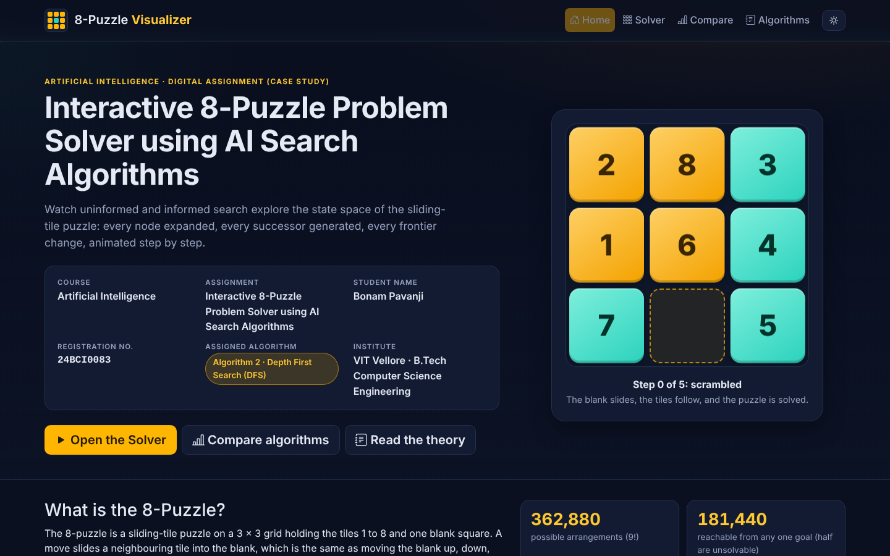
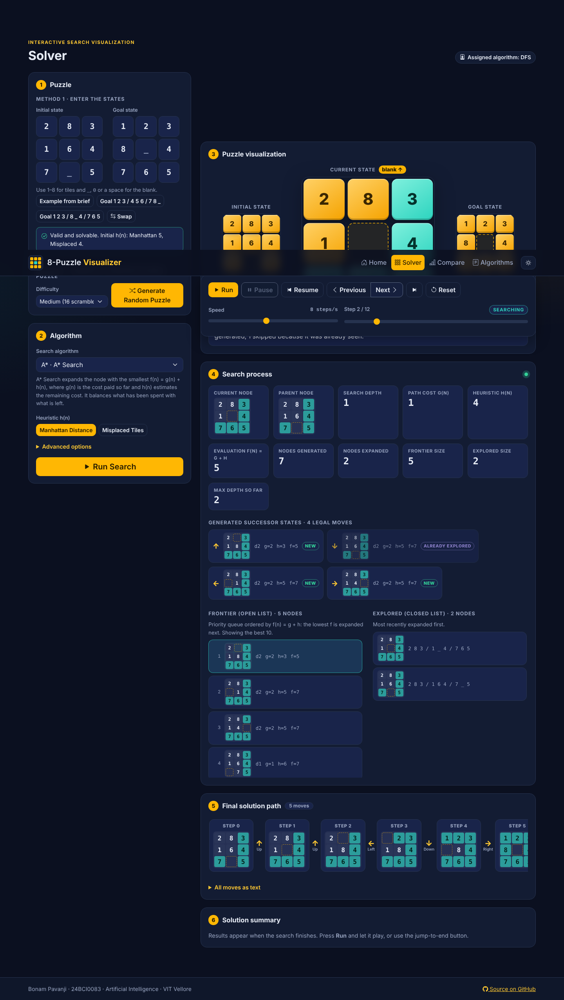
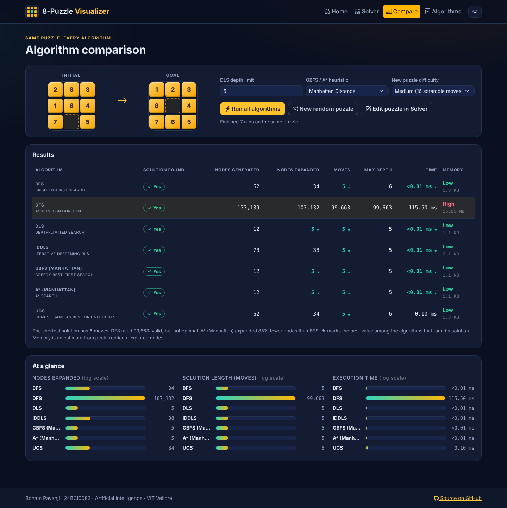
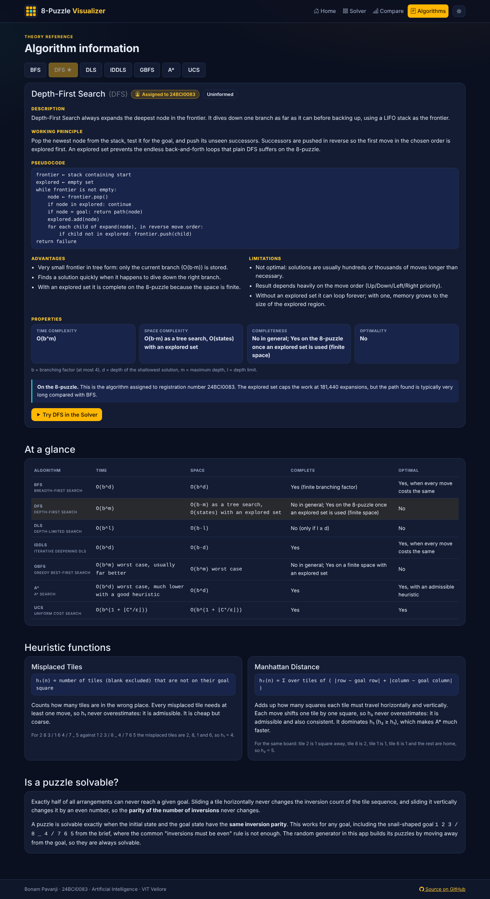
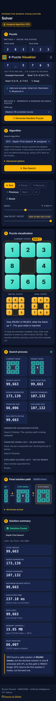

# AI-8Puzzle-Visualizer

**Interactive 8-Puzzle Problem Solver using AI Search Algorithms**
Artificial Intelligence · Digital Assignment (Case Study)

Live site: https://pavanjibonam-cmyk.github.io/AI-8Puzzle-Visualizer
Repository: https://github.com/pavanjibonam-cmyk/AI-8Puzzle-Visualizer



## Project Description

A single-page web application that models the 8-puzzle as a state-space search problem and shows, step by step, how uninformed and informed search algorithms explore it. The user enters (or randomly generates) an initial and goal state, picks an algorithm, and watches the blank tile move while the current node, parent, depth, g/h/f values, frontier and explored list update in real time. A comparison page runs every algorithm on the same puzzle, and an information page documents each algorithm.

All search algorithms are implemented **from scratch** in plain JavaScript. No search or AI libraries are used.

## Student Details

| | |
|---|---|
| Name | Bonam Pavanji |
| Registration number | 24BCI0083 |
| Course | Artificial Intelligence |
| Institute | VIT Vellore, B.Tech Computer Science Engineering |
| Assigned algorithm | **Algorithm 2: Depth First Search (DFS)** (from the assignment's allocation table) |

DFS is the showcase algorithm of this project and has its own explanation, pseudocode and analysis. The other algorithms are included because the assignment's required pages (algorithm selector, six-algorithm comparison table, GBFS/A* heuristics) need all of them.

## Technologies Used

- HTML5, CSS3, JavaScript (ES6), no build step
- Bootstrap 5.3.3 (UI framework) and Bootstrap Icons 1.11.3, both vendored in `assets/vendor/` so the site works offline
- CSS transforms for the animated tile movement (no animation library)
- Node.js (tests only) and Playwright (browser tests only)

## Search Algorithms Implemented

| Algorithm | Frontier | Notes |
|---|---|---|
| BFS | FIFO queue | Optimal for unit costs |
| **DFS** (assigned) | LIFO stack + explored set | Graph search, so it terminates on the finite 8-puzzle; not optimal |
| DLS | LIFO stack + depth-aware table | Reports *cutoff* vs *no solution* |
| IDDLS | repeated DLS, limits 0, 1, 2, … | Optimal for unit costs |
| GBFS | priority queue on h(n) | Not optimal |
| A* | priority queue on f(n) = g + h | Optimal with admissible h |
| UCS (bonus) | priority queue on g(n) | Equals BFS when every move costs 1 |

Implementation decisions worth knowing:

- **Goal test on expansion.** A node is tested when it is selected for expansion, for every algorithm. This keeps UCS and A* optimal and makes the visualisation consistent.
- **DFS move order.** Successors are pushed in reverse so the first move in the chosen order (default Up, Down, Left, Right) is explored first. The order is selectable under *Advanced options* and changes what DFS finds a lot.
- **DFS with an explored set** is complete here (181,440 reachable states), so it never exceeds 181,440 expansions. It is far from optimal. On the brief's example with the default move order it finds a valid path of about 100,000 moves where the optimum is 5.
- **DLS and IDDLS** remember the shallowest depth at which each board was expanded and re-expand a board only when it is reached more shallowly. This is complete within the limit and keeps IDDLS tractable.
- **Safety cap** (default 1,000,000 expansions, selectable) stops a search before it can freeze the page. IDDLS on a 31-move puzzle needs about 2.9 million expansions, so with the default cap it reports *"Stopped: safety limit reached"* instead of hanging.
- **Solvability** is checked as *equal inversion parity of initial and goal*, which is correct for any goal (including the snail goal `1 2 3 / 8 _ 4 / 7 6 5` from the brief, where the usual "inversions must be even" rule is wrong).
- **Random puzzles** are generated by moving away from the goal (Easy 8, Medium 16, Hard 28 scramble moves) or by a parity-corrected shuffle (Fully random), so they are always solvable.
- **Playback** records the whole search once, then replays it with a pointer. Run, Pause, Resume, Next, Previous, Speed and the timeline slider are all pointer operations, so *Previous Step* is exact. Very long searches are sampled (every n-th expansion shown) and the UI says so; counters and the summary always come from the full run.
- **Statistics.** Time is measured on a separate run without animation (best of several for fast searches). Memory is approximate: peak (frontier + explored) nodes × ~96 bytes.

## Heuristics Used

| Heuristic | Definition | Admissible | Consistent |
|---|---|---|---|
| Misplaced Tiles | number of tiles (blank excluded) not on their goal square | yes | yes |
| Manhattan Distance | sum over tiles of \|row − goal row\| + \|col − goal col\| | yes | yes |

Manhattan dominates Misplaced Tiles (h₂ ≥ h₁), so A* with Manhattan expands no more nodes than with Misplaced Tiles. For the brief's example the initial values are h₁ = 4 and h₂ = 5.

## Features (mapped to the assignment)

1. **Home page**: course, title, name, registration number, 8-puzzle introduction, navigation menu
2. **Puzzle input**: manual 3×3 grids with validation (and paste support), plus *Generate Random Puzzle*; unsolvable puzzles are detected and can be fixed with one click
3. **Algorithm selection**: BFS, DFS, DLS, IDDLS, GBFS, A*; depth limit for DLS; Manhattan / Misplaced Tiles for GBFS and A*
4. **Puzzle visualisation**: initial, goal and current state, generated successor states, final solution path, animated blank movement
5. **Search process**: current node, parent, nodes generated/expanded, frontier, explored list, depth, path cost; h(n), g(n), f(n) for GBFS and A*
6. **Solution summary**: found / not found, moves, generated, expanded, max depth, time, path cost, approximate memory
7. **Comparison page**: all algorithms on one puzzle in a table, with bar charts
8. **Algorithm information page**: description, working principle, pseudocode, advantages, limitations, time/space complexity, completeness, optimality
9. **Controls**: Run, Pause, Resume, Next Step, Previous Step, Reset, Speed (plus jump-to-end, a timeline slider and keyboard shortcuts: Space, ← →)

Extras: dark/light theme, responsive layout, keyboard and screen-reader support.

## Screenshots

| Solver (A* mid-search) | Comparison |
|---|---|
|  |  |

| Algorithm information | Mobile |
|---|---|
|  |  |

More: `images/solver-dfs-done.png` (DFS result), `images/solver-light.png` (light theme).

## How to Run the Project

No installation or build is needed.

**Option A: open it.** Double-click `index.html`. It works from `file://` because there are no modules or network requests.

**Option B: local server.**
```bash
python3 -m http.server 8000
# open http://localhost:8000
```

**Run the tests (optional).**
```bash
node tests/run-tests.js                 # algorithm and puzzle-model tests (about 2-3 minutes)
pip install playwright && python3 tests/e2e.py http://localhost:8000/index.html
```
The unit tests cross-check every optimal algorithm against an independent BFS, verify solvability against exhaustive reachability of all 362,880 boards, solve the hardest 31-move puzzle, and exercise the safety cap, unsolvable inputs and trace recording. The browser test drives every page, control and algorithm and checks for console errors.

## Deployment (GitHub Pages)

1. Push this folder to a repository named `AI-8Puzzle-Visualizer`.
2. Repository *Settings → Pages → Build and deployment*: Source **Deploy from a branch**, Branch **main**, folder **/ (root)**.
3. The site appears at `https://<username>.github.io/AI-8Puzzle-Visualizer`.

All asset paths are relative, so it works under the repository sub-path.

## Repository Structure

```
AI-8Puzzle-Visualizer/
├── index.html            single-page app (Home, Solver, Compare, Algorithms)
├── css/style.css         themes, board, layout
├── js/
│   ├── puzzle.js         state model, moves, solvability, heuristics, random generation
│   ├── heap.js           binary min-heap (priority queue)
│   ├── algorithms.js     BFS, DFS, DLS, IDDLS, GBFS, A*, UCS + trace recorder
│   ├── info.js           algorithm and heuristic documentation text
│   ├── board.js          animated board and mini-board rendering
│   ├── solver.js         Solver page: input, playback, live stats, summary
│   ├── compare.js        Comparison page
│   ├── pages.js          Algorithm information page
│   └── app.js            routing, theme, home animation
├── assets/vendor/        Bootstrap and Bootstrap Icons (local copies)
├── images/               screenshots
├── docs/                 design notes, demo-video script, submission checklist
└── tests/                unit tests (Node) and browser tests (Playwright)
```

## References

- Russell, S. and Norvig, P., *Artificial Intelligence: A Modern Approach*, 4th ed., Pearson. Chapters 3 and 4 (search, heuristics, the 8-puzzle).
- Course material for Artificial Intelligence, VIT Vellore.
- Johnson, W. W. and Story, W. E. (1879), "Notes on the 15 Puzzle", *American Journal of Mathematics* 2(4): the parity argument behind solvability.
- Bootstrap 5.3.3, https://getbootstrap.com (MIT licence), and Bootstrap Icons 1.11.3, https://icons.getbootstrap.com (MIT licence). Licences are kept in `assets/vendor/`.
- Playwright, https://playwright.dev (used only for browser testing).
- Claude (Anthropic) was used as an AI assistant to help build and test this project.
